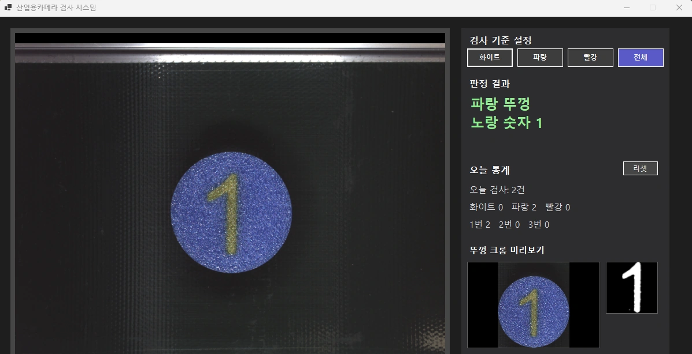
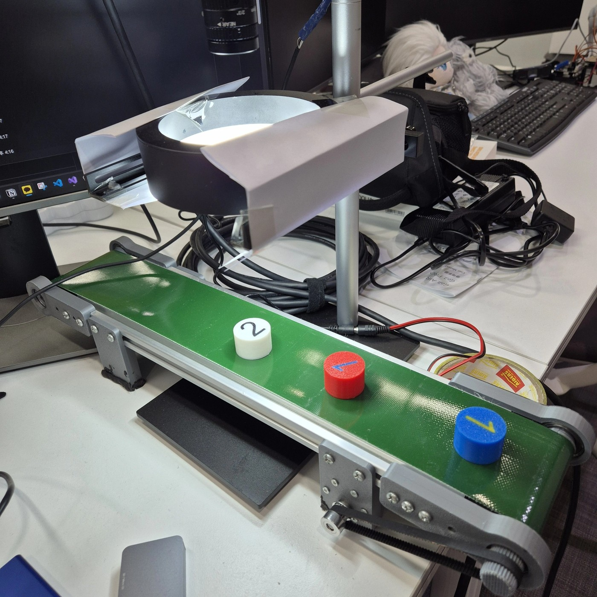

# CameraNumberDetect — 산업용 카메라 뚜껑 검사 시스템

컨베이어벨트 위를 지나가는 뚜껑의 **색(화이트·파랑·빨강)과 숫자(1·2·3)를 실시간으로 인식**해 양품/불량을 판정·집계하고, 결과를 UDP로 Unity 디지털트윈에 전송하는 Windows 데스크톱 프로그램입니다.

🔗 [Portfolio](https://subinlu22.github.io) · [CameraDigitalTwin (Unity 연동)](https://github.com/subinlu22/CameraDigitalTwin)

<p align="center">
  <br>
  <sub>판정 결과(파랑 뚜껑 / 노랑 숫자 1), 오늘 통계, 뚜껑 크롭과 CNN 입력 마스크 미리보기</sub>
</p>

---

## 데모

| [](https://youtu.be/c8xXRFmwOio) | [](https://youtube.com/shorts/ry1GkGROjFs) |
|---|---|
| 다각도 촬영 데이터를 활용한 숫자 인식 모델 학습 | 학습 모델 기반 숫자 인식 성능 검증 |

## 프로젝트 개요

| 항목 | 내용 |
|---|---|
| 기간 | 2026.08 ~ 2026.10 |
| 인원 / 역할 | 1인 — 영상 처리, CNN 학습, C# 프로그램, Unity 연동 전 과정 |
| 목적 | 컨베이어 위 뚜껑의 색과 숫자를 자동 판정하고, 결과를 가상 공간(디지털트윈)에 동기화 |
| 최종 목표 | 숫자·컬러 인식 → 아두이노 분류 → 로봇팔로 집어 분리 |

## 구현 현황

| 기능 | 상태 |
|---|---|
| 카메라 SDK 연동 (프레임 수신) | ✅ |
| 배경 학습(MOG2) 기반 뚜껑 위치 검출 | ✅ |
| HSV 색 판정 (화이트·파랑·빨강) | ✅ |
| CNN 숫자 인식 (PyTorch 학습 → ONNX Runtime 추론) | ✅ 검증 정확도 99.3% |
| 벨트 이동 중 인식, 연속 투입 카운트 | ✅ 4cm 간격에서 누락 없음 |
| 대시보드 UI · 양품/불량 필터 · 검사 로그(CSV) | ✅ |
| 배경 학습 저장/불러오기 | ✅ |
| Unity 디지털트윈 UDP 전송 | ✅ |
| 아두이노 분류 → 로봇팔 연동 | 🔲 다음 단계 |

**시행착오 — 시도했다가 바꾼 것**

| 시도 | 문제 | 바꾼 방식 |
|---|---|---|
| 숫자 판정을 패턴매칭(MatchShapes / Hu Moments)으로 구현 | 파랑·빨강은 글리터 재질이라 색마다 마스크 노이즈가 달라 같은 숫자도 Hu Moments 값이 흔들림. 정해진 템플릿만 맞히는 구조라 확장도 어려움 | CNN 학습으로 전환 (445장 → 748장), ONNX로 변환해 C#에서 추론. 검증 정확도 99.3% |
| 노출만 조절해 반사와 번짐 해결 | 50000 → 8000 → 15000+게인20 등으로 바꿔도 정반사는 남고, 노출이 길면 이동 중 모션블러로 원형이 무너짐 | MVS에서 실시간으로 보며 37021 / 1.6155로 실측 확정, 레일 반사는 종이 가림막으로 물리 차폐 |
| 짧게 배경 학습 | 반복되는 벨트 무늬를 다 익히지 못해 오히려 노이즈 후보가 늘어남 | 벨트가 여러 바퀴 돌 때까지 학습, 시작/종료를 버튼으로 직접 조절 |
| 화이트 뚜껑과 반사를 밝기 표준편차로 구분 | 화이트 뚜껑은 검정 숫자 때문에 표준편차가 커서 진짜 뚜껑까지 제거됨 | 필터를 빼고 원형도(볼록껍질 기준) + 면적비로 구분 |
| 조명·높이를 바꾼 뒤 데이터 증강만으로 재학습 | 증강 이미지와 새 조명의 실제 분포가 달라 오인식이 줄지 않음 | 부족한 조합(파랑1·2, 빨강1·2·3)을 새 조명에서 재촬영해 재학습 |
| 연속 투입 누락을 투표 방식(지나가는 동안 최다값)으로 해결 | [CNT] 로그로 확인해 보니 원인은 판정이 아니라 잠금 해제 조건이었음 | 위치 점프(boxX 100px 이상 후퇴)로 새 뚜껑을 판단해 잠금 해제 |
## 환경

| 구분 | 내용 |
|---|---|
| OS / IDE | Windows, Visual Studio 2022 |
| 런타임 | .NET 8 (Windows Forms) |
| 언어 | C# (프로그램), Python (모델 학습) |
| 카메라 | Hikrobot MV-CU050-30GC (GigE) + MVS SDK |
| 조명 / 장비 | 링라이트(반사 차폐용 종이 가림막 부착), 미니 컨베이어벨트 |
| 카메라 설정 | ExposureTime 37021, Gain 1.6155 (MVS에서 실측해 고정) |

<p align="center">
  <br>
  <sub>실제 장비: 링라이트와 가림막, 컨베이어벨트, 뚜껑</sub>
</p>

## 기술 스택

| 분류 | 기술 |
|---|---|
| 영상 처리 | OpenCvSharp (OpenCV) |
| 숫자 인식 | PyTorch (학습), ONNX Runtime (추론) |
| UI | Windows Forms |
| 통신 | UDP (Unity 연동) |
| 하드웨어 SDK | Hikrobot MVS SDK (GigE) |

## 시스템 구조

```
Hikrobot 카메라 (GigE)
   │  프레임 수신 → Bayer→BGR→RGB 변환 → 1/3 축소
   ▼
배경 학습(MOG2) 전경 마스크 → 원형도 필터로 뚜껑 위치 검출
   │
   ├─ ClassifyLidColor ........ HSV 평균으로 색 판정
   └─ CropLidArea → ExtractDigitPatchForCnn → RunDigitInference (ONNX, 64×64)
   ▼
같은 결과가 3프레임 연속 → RecordInspection
   ├─ 대시보드 갱신 · 검사 로그 CSV 기록
   └─ UDP(5053) → Unity 디지털트윈
```

## 검사 대상 사양

| 구분 | 내용 |
|---|---|
| 뚜껑 색 | 화이트 / 파랑 / 빨강 (파랑·빨강은 글리터 재질) |
| 숫자 | 1 / 2 / 3 (글리터 재질 마커) |
| 색별 숫자 색 | 화이트 → 검정 / 파랑 → 노랑 / 빨강 → 파랑 |

## 판정 기준 · 설정값

| 항목 | 값 |
|---|---|
| 색 판정 (HSV) | Sat < 40 화이트 / Hue ≤ 45 또는 ≥ 155 빨강 / Hue 100~130 파랑 / 그 외 판정불가 |
| 배경 학습 (MOG2) | history 2000, varThreshold 16, detectShadows = true, 판정 중 learningRate 0, 전경 임계값 50 |
| 원형도 | 0.6 이상 (볼록껍질 기준) |
| 뚜껑 면적비 | 3~20% |
| 분석 제외 구간 | 좌우 각 25% (레일 반사 회피) |
| 카운트 확정 | 같은 결과 3프레임 연속 |
| 새 뚜껑 판단 | boxX가 100px 이상 뒤로 점프하면 잠금 해제 |
| 없음 인정 | 8프레임 연속 (안전장치) |
| 최소 크롭 크기 | 가로·세로 20px 미만이면 "못 찾음" |

## CNN 숫자 인식

| 항목 | 내용 |
|---|---|
| 데이터 | 9개 조합(색 3 × 숫자 3), 748장 (자동 연속 촬영 모드로 수집) |
| 모델 | Conv-Pool 3층 + FC + Dropout |
| 입력 | 64×64 숫자 마스크 |
| 추론 | ONNX Runtime (C#) |

**전처리 순서** (Python 학습 코드 `extract_digit_patch()`와 C# `ExtractDigitPatchForCnn()`이 동일해야 함)

1. 원형 ROI (반지름 = 짧은 변의 48%)
2. 원 안 픽셀의 median을 배경색으로 추정
3. GaussianBlur(7×7)
4. 배경색과의 거리 계산 → 정규화
5. GaussianBlur(5×5) → Otsu 이진화
6. 열림(3×3) / 닫힘(7×7)
7. 가장 큰 윤곽선을 정사각형으로 크롭 → 64×64

## UDP 메시지 (포트 5053)

| type | 전송 시점 |
|---|---|
| `inspection` | 카운트가 확정된 순간 검사 결과 1건 |
| `criterion` | 검사 기준(색) 버튼을 눌러 기준이 바뀔 때 |

## 측정 결과

| 항목 | 결과 |
|---|---|
| 숫자 인식 검증 정확도 | 99.3% (748장, 새 조명 기준 재학습) |
| 9개 조합(색 × 숫자) 정지 상태 인식 | 전부 성공 |
| 연속 투입 | 4cm 간격에서도 카운트 누락 없음 |
| 시작 시 배경 학습 시간 | 약 200초 → 저장/불러오기 적용 후 수 초 |

## 설계 결정과 근거

| 결정 | 근거 |
|---|---|
| 숫자 판정을 패턴매칭에서 CNN으로 전환 | 색별 글리터 노이즈 때문에 Hu Moments가 달라져 오인식. 학습으로 확장 가능하고 위치·각도·조명 변화에 강함 |
| 위치 검출에 배경 학습(MOG2) 사용 | 벨트 반사광과 짜임이 뚜껑 후보로 잡혀서 배경 모델로 제거 |
| 원형도를 볼록껍질 기준으로 계산 | 벨트 짜임 때문에 마스크 경계가 톱니 모양이라 원본 윤곽선 기준 원형도가 0.1~0.3으로 낮게 나옴 |
| 연속 뚜껑 판단을 "위치 점프"로 구현 | 벨트가 한 방향이라 같은 뚜껑이면 boxX가 커지기만 함. "사라질 때까지 대기" 방식은 촘촘히 투입하면 깨짐 |
| 배경 학습 저장을 "입력 사진 저장 후 재학습"으로 구현 | MOG2는 학습 상태를 파일로 저장하는 기능이 없음 |
| 학습·추론 전처리를 동일하게 유지 | 한쪽만 바꾸면 학습 때와 다른 입력이 들어가 오히려 정확도가 떨어짐 |

## 트러블슈팅

| 문제 | 원인 | 해결 |
|---|---|---|
| 정지 상태는 되는데 벨트가 움직이면 인식 실패 | ExposureTime 50000(50ms)으로 모션블러가 생겨 원형도 필터 자체가 무너짐 | 노출을 실측값으로 낮추고 게인으로 보정 |
| 파랑·빨강 뚜껑만 엉뚱한 숫자로 고정 | CNN 입력을 화면에 띄워 확인해 보니 숫자 대신 글리터 반짝임이 가득. 색 거리 계산이 글리터 입자를 배경과 다른 픽셀로 인식 | 색 거리 계산 **전에** GaussianBlur(7×7) 적용, 학습(Python)·추론(C#) 전처리를 똑같이 맞춰 재학습 |
| 연달아 올리면 두 번째부터 카운트 누락 | 잠금 해제 조건이 "뚜껑이 8프레임 연속 사라짐" 하나뿐. 뚜껑 지름 약 246px, 판정 구간 432px라 4cm 간격이면 화면이 비는 순간이 없음 | 벨트가 한 방향이라는 점을 이용해, boxX가 100px 이상 뒤로 점프하면 새 뚜껑으로 판단 |
| 크롭은 되는데 색 판정만 실패 | 크롭과 색 판정이 서로 다른 마스크를 기준으로 동작 | 둘 다 같은 원형 윤곽선을 기준으로 통일 |
| 빨강 뚜껑이 판정불가로 나옴 | 실제 빨강 뚜껑은 오렌지·구릿빛에 가까워 실측 Hue가 40 근처 | 실측 기준으로 빨강 Hue 범위를 25 → 45로 확장 |
| 켤 때마다 배경 학습에 약 200초 | MOG2는 학습 상태를 파일로 저장하는 기능이 없음 | 학습 중 본 장면을 0.5초마다 PNG로 저장했다가 다음 실행 때 다시 학습시킴 (한 장만 저장하면 벨트 무늬의 흔들림 폭을 못 배워서 여러 장) |

## 프로젝트 구조

```
CameraNumberDetect/
├── Form1.cs                 # 프레임 처리, 판정, 대시보드 UI, UDP 전송
├── train_digit_cnn.py       # CNN 학습 (전처리는 Form1.cs와 동일하게 유지)
├── digit_cnn.onnx           # 학습된 모델 (실행 폴더에 필요)
├── label_map.json           # 클래스 매핑 (실행 폴더에 필요)
├── TrainingData/            # 학습 이미지 (색_숫자 폴더별, git 제외)
└── InspectionLog.csv        # 검사 로그 (실행 시 생성)
```

## 실행 방법

1. Visual Studio 2022, .NET 8 SDK, Hikrobot **MVS SDK**를 설치하고 GigE 카메라를 연결합니다.
2. 솔루션 파일을 열어 빌드합니다.
3. 실행 파일 폴더에 `digit_cnn.onnx`, `label_map.json`을 둡니다.
4. 처음 실행할 때는 벨트를 돌리면서 **배경 학습 시작** 버튼을 누르고, 벨트가 여러 바퀴 돈 뒤 같은 버튼을 다시 눌러 학습을 마칩니다. 학습한 배경은 저장되어 다음 실행부터 자동으로 불러옵니다.
5. 뚜껑을 벨트에 올리면 판정 결과와 통계가 표시됩니다.

**학습 데이터 수집**: 실행 중 키 `1` / `2` / `3`으로 자동 연속 촬영을 토글합니다. 완성형으로 판정된 프레임만 5프레임마다 `TrainingData\색_숫자\`에 저장됩니다.

---

🔗 [Portfolio](https://subinlu22.github.io)
